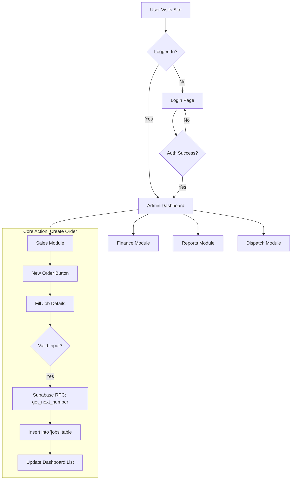
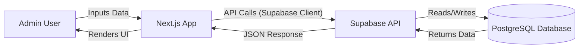

# Aayam Office System - Project Blueprint

## 1. Project Overview
**Aayam Office System** is a comprehensive ERP (Enterprise Resource Planning) solution designed for printing and manufacturing businesses. It handles the entire lifecycle from client management to job production, dispatch, and financial tracking.

### Technology Stack
- **Frontend**: Next.js 14 (App Router), React, TypeScript, Tailwind CSS
- **Backend / Database**: Supabase (PostgreSQL)
- **Authentication**: Supabase Auth (Email/Password) & Custom Profile Management
- **State Management**: React Hooks (`useAuth`, `useJobs`, etc.) & Local Storage for fallback
- **Icons**: Lucide React

---

## 2. Architecture & File Structure

### Core Directories
- **`/app`**: Contains the application routes (Pages).
  - `(admin)/`: Protected routes for the dashboard (Dashboard, Sales, Finance, etc.).
  - `login/`: Authentication page.
  - `emergency/`: Disaster recovery access page.
  - `api/`: Server-side API handlers (minimal use, mostly direct Supabase calls).
- **`/components`**: Reusable UI elements.
  - `layout/`: Sidebar, Header, AdminLayout.
  - `ui/`: Buttons, Cards, Modals, Inputs.
- **`/lib`**: Utility functions and Contexts.
  - `supabase.ts`: Supabase client initialization.
  - `auth-context.tsx`: Manages user login state and session persistence.
  - `hooks.ts`: Custom hooks for data fetching (`useJobs`, `useClients`, etc.).
- **`/types`**: TypeScript definitions.
  - `database.ts`: Explicit interfaces for all database tables (Jobs, Clients, Invoices).
- **`/supabase`**: Database scripts.
  - `FRESH_START.sql`: The master script to recreate the database schema.

---

## 3. Database Schema
The system is built on a relational database design managed by Supabase.

### Primary Tables
1.  **`profiles`**: Extends standard auth users with roles (`admin`, `manager`) and `is_active` status.
2.  **`clients`**: Customer database (Companies/Individuals) with credit limits and balances.
3.  **`jobs`** (Orders): The core entity. Tracks production jobs from 'New' to 'Delivered'.
    - *Relations*: foreign keys to `clients`, `vendors`, `designers`.
4.  **`invoices`**: Billing records linked to Jobs and Clients.
5.  **`expenses`**: Company expenses logic.
6.  **`dispatches`**: Delivery tracking, shipping details.
7.  **`counters`**: Auto-incrementing sequences for Job Numbers (e.g., `AAY-26-001`).

### Security (RLS)
- Currently configured with **RLS Disabled** on primary tables to ensure ease of use for the internal team without complex permission policies blocking access.
- Security is handled via Application Logic (Auth Context).

---

## 4. Key Workflows

### A. Order Processing
1.  **Create Order**: User goes to Sales > New Order.
2.  **Selection**: Selects Existing Client (Required).
3.  **Auto-Numbering**: System calls `get_next_number` RPC function to generate unique Job ID.
4.  **Creation**: Job is saved to `jobs` table via Supabase API.

### B. Financials
- **Invoicing**: Generates distinct Invoice Numbers. Auto-calculates GST.
- **Expenses**: Tracks daily spending categories.
- **Reporting**: Automated aggregation of data for Sales, Finance, and Dispatch reports.

### C. Authentication & Access
- **Standard Login**: Email/Password via Supabase.
- **Emergency Access**: A failsafe route (`/emergency`) to bypass login issues during critical failures, useful for debugging or system lockouts.

---

## 5. Deployment Guide

### Prerequisites
1.  **Node.js**: Version 18+ installed locally.
2.  **Supabase Project**: Active project with URL and Anon Key.

### Environment Setup (`.env.local`)
```env
NEXT_PUBLIC_SUPABASE_URL=https://your-project-id.supabase.co
NEXT_PUBLIC_SUPABASE_ANON_KEY=your-anon-key
```

### Running Locally
```bash
npm install
npm run dev
```

### Deploying to Production (Vercel)
1.  Push code to GitHub.
2.  Import project in Vercel.
3.  Add Environment Variables (URL & Key) in Vercel Settings.
4.  Deploy.

---

## 6. Troubleshooting
- **Login Loop**: Caused by Auth State mismatch. Fixed by `auth-context.tsx` timeout and fallback storage.
- **Missing Columns**: Caused by schema drift. Fixed by `FRESH_START.sql`.
- **Port Conflicts**: Run `killall node` to clear stuck processes.

## 7. System Workflow Diagrams

### Application Flow


### Data Flow

