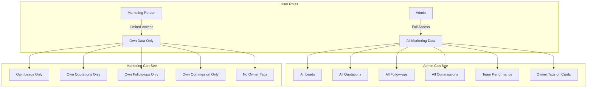
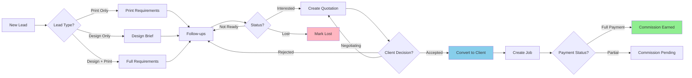
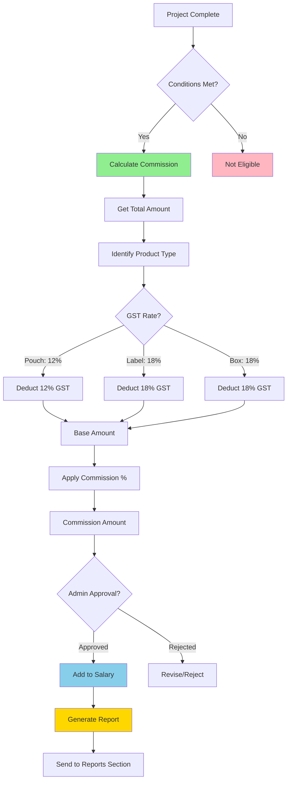
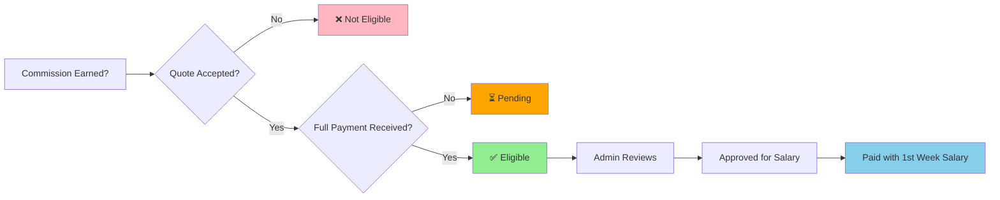
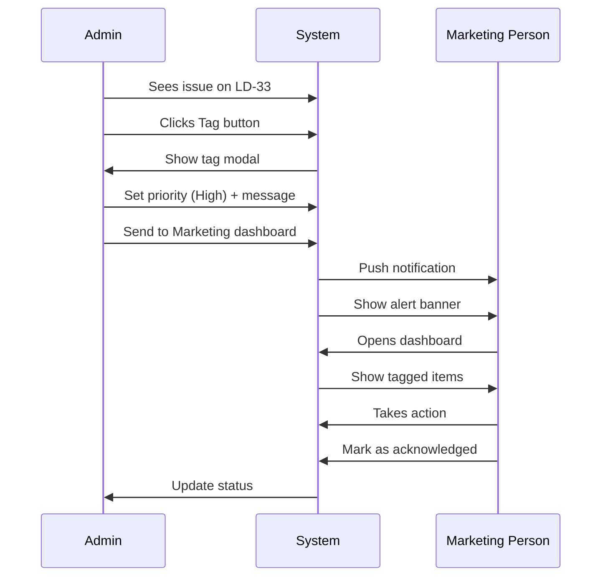
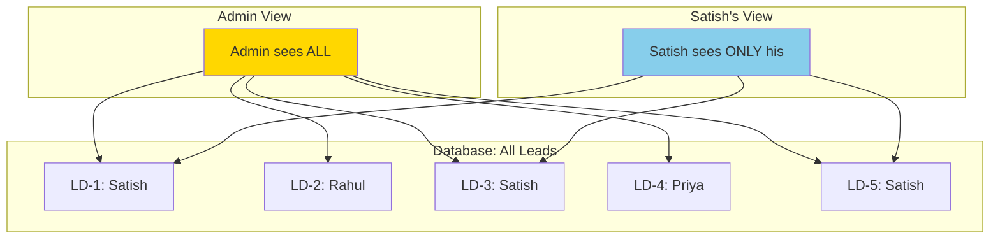

# Marketing Dashboard System - Complete Blueprint

## 📋 System Overview

This document provides a complete visual blueprint of the Marketing Dashboard system to ensure alignment between implementation and requirements.

---

## 🎯 Core Objective

**Goal**: Create a comprehensive admin monitoring dashboard for the marketing team with commission management, data isolation, and enhanced visibility.

---

## 👥 User Roles & Access



**Key Point**: Admin sees EVERYTHING + who owns what. Marketing sees ONLY their own data.

---

## 🔄 Marketing Workflow - Step by Step



**Current Implementation Status**:
- ✅ Lead creation with owner assignment
- ✅ Follow-up management
- ✅ Quotation creation
- ✅ Lead to client conversion
- ✅ Data isolation by owner
- 🔧 Enhanced lead cards (Phase 2 - DONE)
- ⏳ Commission system (Planned)

---

## 📊 Marketing Dashboard - Admin View

### Current Layout (Marketing Page)

```
┌─────────────────────────────────────────────────────────────┐
│  Marketing & CRM                                            │
├─────────────────────────────────────────────────────────────┤
│                                                             │
│  [Leads]  [Clients]  [Quotations]  [Follow-ups]            │
│                                                             │
│  Simple navigation tabs - NO stats here                    │
└─────────────────────────────────────────────────────────────┘
```

### Planned: Admin Marketing Dashboard

```
┌─────────────────────────────────────────────────────────────┐
│  Admin Marketing Dashboard                          Satish V│
├─────────────────────────────────────────────────────────────┤
│                                                             │
│  📊 Quick Stats (Clickable)                                 │
│  ┌──────────┬──────────┬──────────┬──────────┬──────────┐  │
│  │ Today's  │ Overdue  │  New     │ Converted│  Waiting │  │
│  │ Follow   │  Tasks   │  Leads   │  Leads   │  Leads   │  │
│  │   12     │    3     │    8     │    5     │    10    │  │
│  └──────────┴──────────┴──────────┴──────────┴──────────┘  │
│                                                             │
│  👥 Team Performance (This Month)                           │
│  ┌─────────────────────────────────────────────────────┐   │
│  │ 👤 Satish V        5 leads  │  3 converted │ ₹45,000 │   │
│  │ 👤 Rahul K         8 leads  │  2 converted │ ₹30,000 │   │
│  │ 👤 Priya M         6 leads  │  4 converted │ ₹80,000 │   │
│  └─────────────────────────────────────────────────────┘   │
│                                                             │
│  💰 Commission Overview                                     │
│  ┌─────────────────────────────────────────────────────┐   │
│  │ This Month: ₹8,500  │  Pending: ₹12,000             │   │
│  │ Approved: ₹8,500    │  Paid: ₹0 (Salary pending)    │   │
│  └─────────────────────────────────────────────────────┘   │
│                                                             │
│  📋 Recent Activity Feed                                    │
│  ┌─────────────────────────────────────────────────────┐   │
│  │ 🎯 Satish created quotation QT-234 for Major Kevin    │   │
│  │ ✅ Priya converted LD-45 to client                    │   │
│  │ 📞 Rahul added follow-up for MS Dhoni                 │   │
│  └─────────────────────────────────────────────────────┘   │
└─────────────────────────────────────────────────────────────┘
```

**Question for You**: Is this the layout you envision for the admin dashboard?

---

## 🎴 Enhanced Lead Card - Before vs After

### BEFORE (Current - Basic Card)
```
┌─────────────────────────────────────┐
│ LD-33                               │
│ Major Kevin                         │
│ Nirma Agro                          │
│                                     │
│ 📞 7510295758157                     │
│                                     │
│ [NEW]                  [Edit] [❌]  │
└─────────────────────────────────────┘
```

### AFTER (Phase 2 - Implemented ✅)
```
┌─────────────────────────────────────────────────────────┐
│ LD-33  👤 Satish V (Admin only)                         │
│ Major Kevin                                             │
│ Nirma Agro                                              │
│                                                         │
│ ✨ Design + Print                                       │
│                                                         │
│ ┌───────────────────────────────────────────────────┐   │
│ │    Qty       │    Amount    │    Deadline        │   │
│ │   5,000      │   ₹50,000    │   28 Jan 2026      │   │
│ └───────────────────────────────────────────────────┘   │
│                                                         │
│ 📞 7510295758157                                         │
│ "nirma washing powder bags..."                         │
│                                                         │
│ [CONVERTED]                           [Edit] [❌]      │
└─────────────────────────────────────────────────────────┘
```

**Features Added**:
- ✅ Owner tag (👤 Satish V) - Admin only
- ✅ Project type badge (Print/Design/Design+Print)
- ✅ Project details panel (Qty, Amount, Deadline)
- ✅ Better visual hierarchy

**Question for You**: Does this card show the right information? Any additions/removals needed?

---

## 💰 Commission System - Complete Flow



### Commission Eligibility Conditions



### Commission Calculation Example

**Scenario**: Pouch project for Major Kevin

```
Project Total (incl. GST):     ₹56,000
Product Type:                  Pouch
GST Rate:                      12%

Step 1: Remove GST
Base Amount = 56,000 / (1 + 0.12)
Base Amount = ₹50,000

Step 2: Calculate Commission
Commission Rate (Admin Set):   5%
Commission = 50,000 × 0.05
Commission Earned:             ₹2,500

Step 3: Payment
Marketing Person:              Satish V
Status:                        Approved
Payment Date:                  1st week of next month
Method:                        With salary
```

**Question for You**: Is this commission calculation correct? Should anything else be considered?

---

## 🏷️ Admin Intervention System

### How It Works



### Admin View - Any Card
```
┌─────────────────────────────────────────────────┐
│ LD-33  👤 Satish V                       [🏷️]  │
│ Major Kevin                                     │
│ ...                                             │
└─────────────────────────────────────────────────┘
       ↓ Click tag button
┌─────────────────────────────────────────────────┐
│ Tag & Send to Satish V's Dashboard             │
├─────────────────────────────────────────────────┤
│ Priority: [🔴 High - Urgent ▼]                  │
│                                                 │
│ Message:                                        │
│ ┌─────────────────────────────────────────┐     │
│ │ Please update client on deadline change│     │
│ │                                         │     │
│ └─────────────────────────────────────────┘     │
│                                                 │
│          [Cancel]  [Send to Dashboard]          │
└─────────────────────────────────────────────────┘
```

### Marketing Person View
```
┌─────────────────────────────────────────────────┐
│ Marketing Dashboard                      Satish │
├─────────────────────────────────────────────────┤
│ ⚠️ Admin tagged 2 items for your attention      │
│    [View All →]                                 │
├─────────────────────────────────────────────────┤
│ ...rest of dashboard...                        │
└─────────────────────────────────────────────────┘
```

**Question for You**: Is this intervention workflow what you need?

---

## 📈 Commission Reports - Auto-Generated

### Monthly Report Format

```
════════════════════════════════════════════════
        Commission Report - January 2026
════════════════════════════════════════════════

Marketing Person: Satish V

Projects Completed This Month:
────────────────────────────────────────────────
1. LD-33 - Major Kevin (Pouch)
   Total Amount:      ₹56,000
   GST (12%):         ₹6,000
   Base Amount:       ₹50,000
   Commission (5%):   ₹2,500
   Status:            ✅ Paid

2. LD-34 - MS Dhoni (Label)
   Total Amount:      ₹35,400
   GST (18%):         ₹5,400
   Base Amount:       ₹30,000
   Commission (5%):   ₹1,500
   Status:            ✅ Paid

3. LD-35 - Virat Kohli (Box)
   Total Amount:      ₹23,600
   GST (18%):         ₹3,600
   Base Amount:       ₹20,000
   Commission (5%):   ₹1,000
   Status:            ⏳ Pending (Partial payment)

────────────────────────────────────────────────
Total Projects:        3
Eligible Projects:     2
Total Commission:      ₹5,000
Pending Commission:    ₹1,000
────────────────────────────────────────────────
Payment Status:        Approved for Jan Salary
Payment Date:          1st Week Feb 2026
════════════════════════════════════════════════
```

**Actions**:
- ✅ Auto-generate monthly
- ✅ Send to Reports section
- ✅ Export as PDF/Excel
- ✅ Email to team (optional)

**Question for You**: Does this report format cover everything you need?

---

## 🗂️ Sidebar Navigation

### Current Marketing Section (For Marketing Users)
```
Marketing
├─ Leads
├─ Clients  
├─ Quotations
└─ Follow-ups
```

### Planned Admin Section
```
Marketing (Admin Only)
├─ 📊 Dashboard      ← NEW! Full team overview
├─ 📋 Leads          ← All leads with filters
├─ 📞 Follow-ups     ← All follow-ups
├─ 📄 Quotations     ← All quotations
├─ 📦 Orders         ← All orders
└─ 💰 Commissions    ← Commission management
```

**Key Difference**: Admin gets a **Dashboard** page with team stats. Marketing users see simple list navigation.

**Question for You**: Should admin see both the dashboard AND individual pages, or primarily use the dashboard?

---

## 🔐 Data Isolation - How It Works

### Database Level

```sql
-- Example: useLeads hook implementation

-- For Admin
SELECT * FROM leads;  -- All leads

-- For Marketing Person (Satish)
SELECT * FROM leads 
WHERE assigned_to = 'satish-user-id';  -- Only Satish's leads
```

### Visual Representation



**Status**: ✅ Already implemented in Phase 1

---

## ❓ Key Questions for Alignment

Please review the above and answer:

### 1. **Dashboard Layout**
- Is the admin dashboard layout correct?
- Should stats be clickable to filter?
- What else should appear on the dashboard?

### 2. **Lead Cards**
- Are the enhanced lead cards showing the right info?
- Should we add more fields (tags, custom fields, etc.)?

### 3. **Commission System**
- Is the GST calculation approach correct?
- Should commission rates be:
  - Global (same for all)?
  - Per person?
  - Per product type?
  - Combination?

### 4. **Admin Intervention**
- Is the tagging system sufficient?
- Should admin be able to reassign leads to other marketing people?
- Should there be escalation levels?

### 5. **Reports**
- Is the monthly commission report format complete?
- What other reports do you need?
  - Lead conversion rate?
  - Follow-up performance?
  - Quote acceptance rate?

---

## 🎯 What's Done vs What's Planned

### ✅ Completed (Phase 1 & 2)
- User authentication & profiles
- Data isolation (marketing sees only their data)
- Lead management with owner assignment
- Follow-up system
- Quotation creation
- Enhanced lead cards with project details
- Owner tags on cards (admin only)

### ⏳ In Progress / Planned
- Admin marketing dashboard page
- Clickable stats with filtering
- Commission calculation system
- GST-based commission calculator
- Admin intervention/tagging
- Monthly commission reports
- Team performance metrics

---

## 📝 Next Steps - Your Decision

Based on this blueprint, please tell me:

1. **Is the overall direction correct?**
2. **Any major changes needed before continuing?**
3. **Which phase should I prioritize next?**
   - A: Admin Dashboard with stats
   - B: Commission system
   - C: Admin intervention/tagging
   - D: Something else

Let me know your thoughts, and I'll adjust the plan accordingly!
