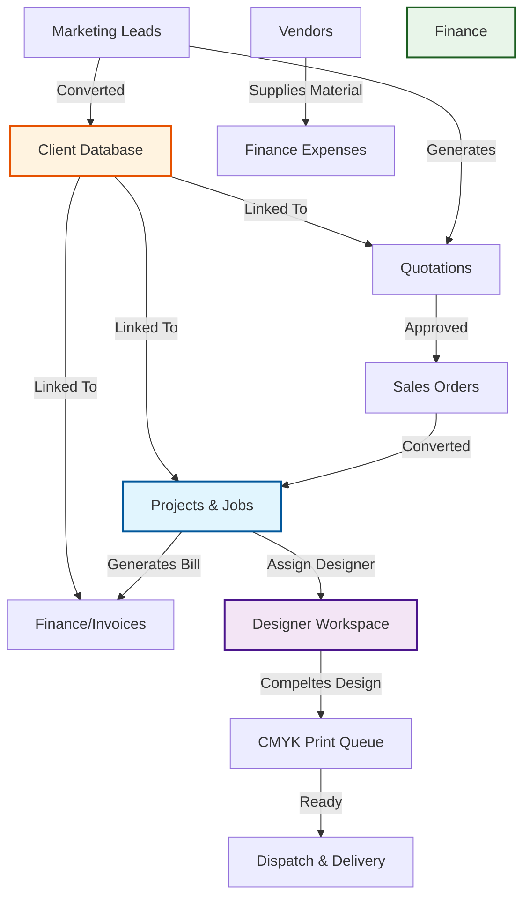

# Aayam Office System - System Flow Guide

This document outlines the structure, data flow, and purpose of every module in the Aayam Office System.

## 1. High-Level Data Flow Diagram
This chart shows how different modules interact with the core database tables.

---

## 2. Sidebar Button Guide
Below is the breakdown of each button in your menu, what data it holds, and its purpose.

### 📊 Overview & Projects
| Button Name | Data Source | Connects To | Purpose |
| :--- | :--- | :--- | :--- |
| **Overview** | All Tables | N/A | **Snapshot:** View total revenue, pending jobs, and active leads at a glance. |
| **Projects & Jobs** | `jobs` table | **Designers**, **Finance**, **Dispatch** | **The Core:** Where you create new work orders. Inputs client info and design briefs. Outputs tasks for designers. |
| **Design Tasks** | `jobs` (filtered) | **Projects** | **For Designers:** A focused view where designers see *only* their assigned work, create notes, and chat. |

### 📢 Marketing & Sales (The Funnel)
| Button Name | Data Source | Connects To | Purpose |
| :--- | :--- | :--- | :--- |
| **Leads** | `leads` table | **Clients** | Track potential customers. When valid, "Convert to Client". |
| **Quotations** | `quotations` | **Orders** | Create price estimates. If approved, "Convert to Order". |
| **Orders** | `orders` | **Jobs** | Confirmed deals awaiting execution. "Convert to Job" moves it to production. |
| **Follow-ups** | `tasks/reminders` | **Leads/Clients** | Schedule calls or meetings so you never forget a customer. |

### 👥 CRM (Relationships)
| Button Name | Data Source | Connects To | Purpose |
| :--- | :--- | :--- | :--- |
| **Clients** | `clients` table | **Jobs**, **Invoices** | **Master Database:** Stores Name, Phone, GST, Address. Referenced by *every* other module. |
| **Vendors** | `vendors` table | **Expenses** | Stores info about printers, paper suppliers, etc. |

### 🎨 Designers Management
| Button Name | Data Source | Connects To | Purpose |
| :--- | :--- | :--- | :--- |
| **Designers Mgmt** | `designers` table | **Jobs** | **Admin Only:** Add new staff, set salaries, upload identity docs (`document_url`), and view performance stats. |

### 🚚 Production & Delivery
| Button Name | Data Source | Connects To | Purpose |
| :--- | :--- | :--- | :--- |
| **CMYK Print** | `jobs` (Stage: Print) | **Dispatch** | Queue for machine operators. Shows jobs that are designed and ready to print. |
| **Dispatch** | `dispatch` | **Clients** | Manage shipping, tracking numbers, and delivery confirmation. |

### ₹ Finance
| Button Name | Data Source | Connects To | Purpose |
| :--- | :--- | :--- | :--- |
| **Finance** | `invoices`, `expenses` | **Bank Accounts** | Track money in (Invoices) vs money out (Vendor Payments, Salaries). |

---

## 3. "Convert" Button Logic
The most powerful features in your system are the **Conversion Buttons** which move data automatically so you don't have to re-type it.

1. **Lead -> Client:** Saves a potential customer permanently.
2. **Client -> Quote:** Starts a pricing estimate.
3. **Quote -> Job:** Turns an estimate into live work.
4. **Job -> Invoice:** Turns finished work into a billable invoice.

This ensures that once a client enters your system as a Lead, their data flows smoothly all the way to the Final Invoice without double entry.
