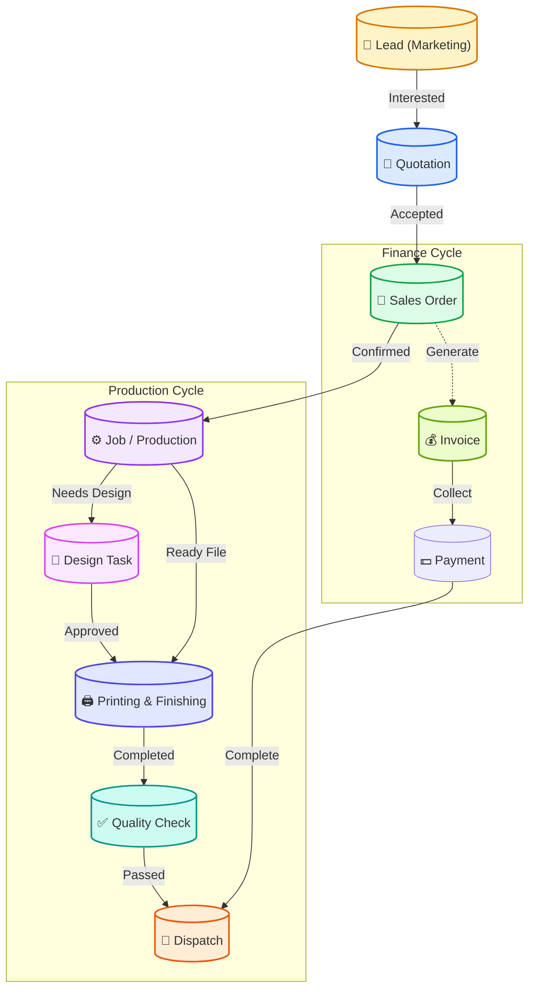

# Aayam Office System - Workflow Blueprint

This document visualizes the complete end-to-end workflow of the Aayam Office System, from the initial Lead to final Dispatch and Payment.

## 1. High-Level System Flow (Graphical)

---

## 2. Step-by-Step Workflow Guide

### Phase 1: Marketing & Sales (Acquisition)
**Role:** Marketing / Admin
1.  **Create Lead**:
    *   Go to **Marketing > Leads**.
    *   Click `+ New Lead`. Enter basic info (Name, Phone, Requirement).
    *   *Action*: Logs the inquiry.
2.  **Follow-Up**:
    *   Go to **Marketing > Follow-ups**.
    *   Track calls and status updates.
3.  **Create Quotation**:
    *   Go to **Marketing > Quotations**.
    *   Click `+ Create Quote`. Select the Lead/Client.
    *   Add Items (Description, Qty, Rate).
    *   *Action*: Generates a PDF Quote.
4.  **Confirm Order**:
    *   Mark Quote as `Accepted`.
    *   Click `Convert to Order`.
    *   This creates a **Sales Order** in **Sales & Finance > Orders**.

### Phase 2: Job Creation (Setup)
**Role:** Admin / Account
1.  **Review Order**:
    *   Go to **Sales & Finance > Orders**.
    *   Verify details.
2.  **Generate Job**:
    *   Click `Create Job` on the Order card.
    *   **Select Job Type**: "Box", "Label", "Visiting Card", etc.
    *   **Assign**: Select a **Designer** (if design needed) or mark "Print Only".
    *   **Deadline**: Set the Client Deadline.
    *   *Action*: Creates a Job entry in the Production system.

### Phase 3: Design Studio (Creative)
**Role:** Designer / Admin
1.  **View Task**:
    *   Designers go to **Design Studio > My Queue** (or Board View).
    *   See newly assigned jobs in `To Do`.
2.  **Start Work**:
    *   Drag card to `In Progress`.
    *   Upload draft files using the `Upload` button.
3.  **Quality Checklist (New!)**:
    *   Click the **QC Checklist** icon (Clipboard).
    *   Check off items: "Bleed Check", "Dimensions", "Spelling".
    *   Save Progress.
4.  **Completion**:
    *   Move card to `Approval` (sent to Client for proofing).
    *   Once approved, move to `Ready for Print`.

### Phase 4: Production (Printing)
**Role:** Admin / Machine Operator
1.  **Print Planner**:
    *   Go to **Projects & Jobs > Print Planner**.
    *   View all jobs marked `Printing`.
    *   Group them by Paper Stock or Machine.
2.  **Processing**:
    *   Mark status as `Finishing` (Lamination, Cutting, Pasting).

### Phase 5: QC & Dispatch (Delivery)
**Role:** Dispatch / Admin
1.  **Final Quality Check**:
    *   Go to **Dispatch**.
    *   Find the Job. Click **QC Checklist** again (switches to Dispatch mode).
    *   Verify physical goods: "Print Quality", "Quantity", "Packaging".
    *   Mark Status: `Passed`.
2.  **Dispatch**:
    *   Click `Create Dispatch`.
    *   Enter Driver Name / Courier details.
    *   Generate **Delivery Challan**.
    *   Update Status to `Dispatched`.

### Phase 6: Finance (Settlement)
**Role:** Account / Admin
1.  **Invoicing**:
    *   Go to **Sales & Finance > Invoices**.
    *   Create Invoice from the Job/Order.
2.  **Payments**:
    *   Go to **Sales & Finance > Payments**.
    *   Record incoming payment (Cash/UPI/Bank).
    *   *Action*: Updates "Outstanding Balance" for the client.

## 3. Hierarchy of Data
*   **Client**: The root entity.
    *   **Leads**: Potential business.
    *   **Quotations**: Proposed business.
    *   **Sales Orders**: Confirmed business.
        *   **Jobs**: Individual executable units (e.g., 1 Order might have 2 Jobs: 1000 Cards + 500 Letterheads).
            *   **Design Task**: The creative work for the job.
            *   **Dispatch**: The delivery record for the job.

